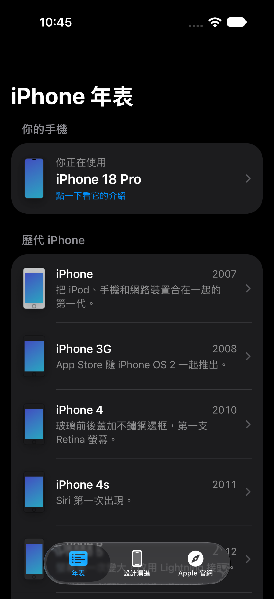
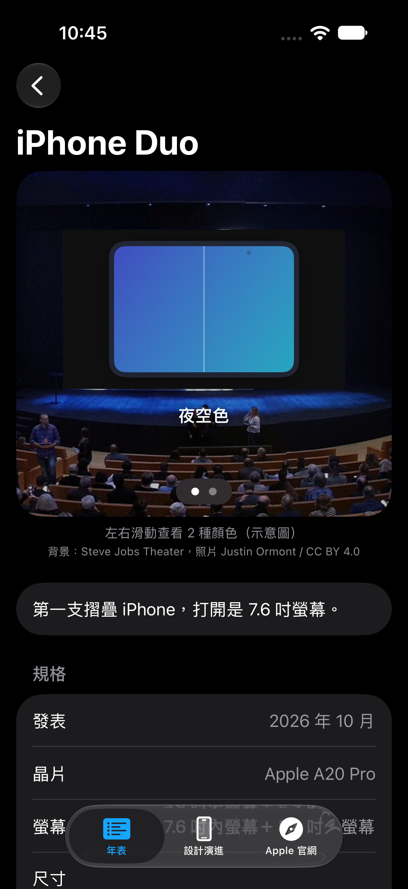
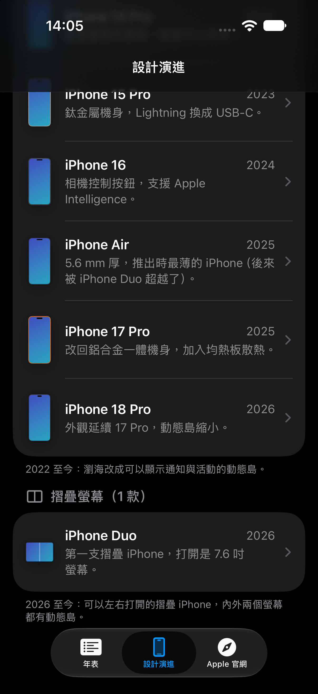
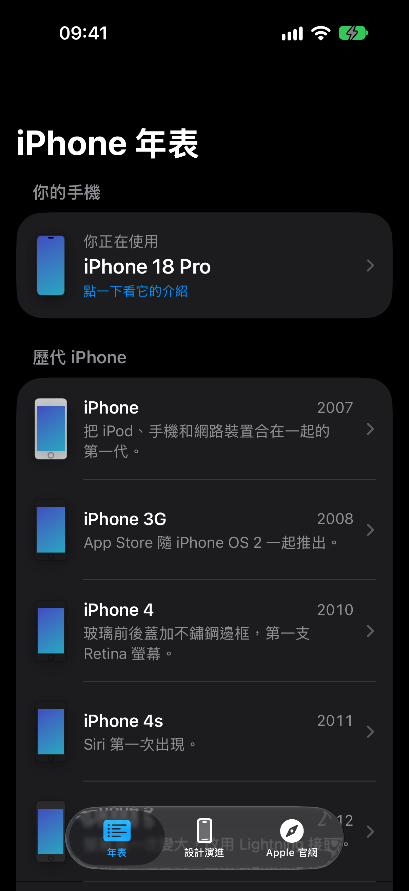
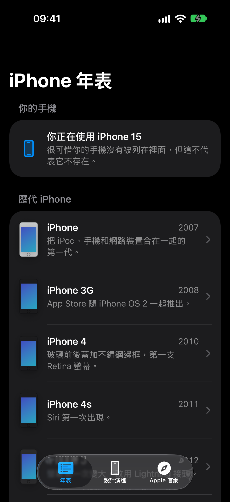
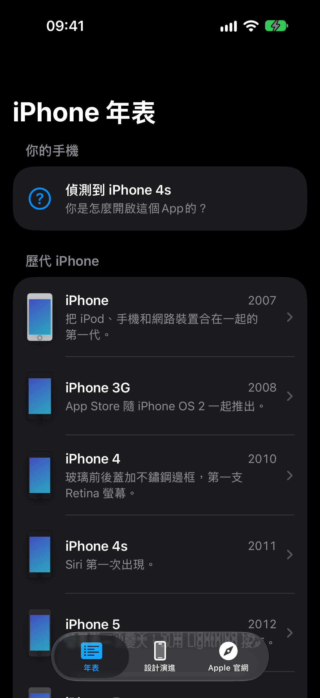
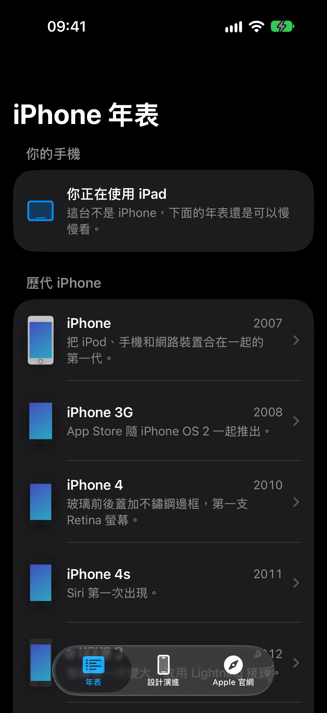

# 歷代 iPhone 大全 iPhoneHistory

從 2007 年第一代 iPhone 到 2026 年的 iPhone 18 Pro 和 iPhone Duo，挑出 23 款有代表性的機型，可以依年份或正面設計瀏覽，查看每款的規格、顏色和維基百科介紹。

<p>
  
  
  
</p>

## 功能

- **年表：**依發表年份列出 23 款 iPhone，每列有手機示意圖、年份和一句話介紹
- **偵測你的手機：**年表最上方顯示使用者目前的機型，點一下進入該機型的介紹；不在列表內、不可能執行這個 App 的舊機型、iPad 各有不同的提示
- **設計演進：**依正面設計分成 Home 鍵、瀏海、動態島、摺疊螢幕四組
- **詳細頁：**背景是 Steve Jobs Theater 的舞台，左右滑動在布幕上切換機身顏色；下方列出晶片、螢幕、尺寸、售價與特色
- **網頁：**「Apple 官網」分頁，以及每款手機的維基百科搜尋頁
- 手機圖案依真實機身長寬比用 SwiftUI 形狀繪製，各世代的瀏海、動態島寬度不同
- iPad 上分頁移到上方，可展開成側邊欄

<p>
  
  
  
  
</p>

## 收錄機型

| 正面設計 | 機型 |
|---|---|
| Home 鍵 | iPhone、iPhone 3G、iPhone 4、iPhone 4s、iPhone 5、iPhone 5s、iPhone 6、iPhone 6s、iPhone SE、iPhone 7、iPhone 8 |
| 瀏海 | iPhone X、iPhone XR、iPhone 11、iPhone 12、iPhone 13 Pro |
| 動態島 | iPhone 14 Pro、iPhone 15 Pro、iPhone 16、iPhone Air、iPhone 17 Pro、iPhone 18 Pro |
| 摺疊螢幕 | iPhone Duo |

## 專案結構

| 檔案 | 內容 |
|---|---|
| `IPhoneModel.swift` | `IPhoneModel`、`FrontDesign`、`Finish` 資料型別與 `IPhoneModel.all` 陣列 |
| `ContentView.swift` | `TabView`：年表、設計演進、Apple 官網三個分頁 |
| `PhoneTimelineView.swift` | 年表列表 |
| `DesignEraView.swift` | 依正面設計分組的列表 |
| `PhoneRow.swift` | 列表中的一列 |
| `PhoneDetailView.swift` | 詳細頁、顏色分頁與 Steve Jobs Theater 背景 |
| `PhoneSilhouette.swift` | 用 SwiftUI 形狀畫的手機示意圖 |
| `DeviceDetector.swift` | 讀取機型代碼並判斷屬於哪種情況 |
| `DeviceBanner.swift` | 年表最上方「你的手機」那一列 |
| `WebPageView.swift` | 用 `UIViewRepresentable` 包 `WKWebView` 的網頁頁面 |
| `iPhoneHistoryApp.swift` | App 進入點，設定分頁圓點顏色 |
| `Info.plist` | 開頭畫面（`UILaunchScreen`） |

## 開發環境

- Xcode 27.2
- iOS 27.0 以上（iPhone、iPad）
- SwiftUI、WebKit

## 執行

1. 用 Xcode 開啟 `iPhoneHistory.xcodeproj`
2. 選擇 iPhone 或 iPad 模擬器，按 ⌘R 執行

Debug 版可以用啟動參數假裝成其他機型，測試「你的手機」的各種情況：

```bash
xcrun simctl launch booted jackuang.iPhoneHistory -DeviceOverride iPhone4,1
```

## 版權聲明

本專案僅為 Swift 課程練習，不做任何商業用途。

- 手機圖案為 SwiftUI 繪製的示意圖，沒有使用 Apple 的產品照片。iPhone 為 Apple Inc. 的商標。
- 詳細頁背景照片：[Steve Jobs Theater - Auditorium](https://commons.wikimedia.org/wiki/File:Steve_Jobs_Theater_-_Auditorium.jpg)，Justin Ormont 攝，以 [CC BY 4.0](https://creativecommons.org/licenses/by/4.0/) 授權；App 內有裁切、調暗，並在布幕區域蓋上黑色。
- 規格資料：晶片、螢幕、尺寸、顏色名稱對照 [Apple 支援 iPhone 技術規格](https://support.apple.com/zh-tw/docs/iphone) 與 Apple 官網技術規格頁；售價與上市月份對照 [Apple Newsroom](https://www.apple.com/newsroom/) 的發表新聞稿；第一代 iPhone 與 iPhone 3G 的處理器參考英文維基百科。

如有侵權疑慮，請開 issue 告知，會立即移除相關內容。
